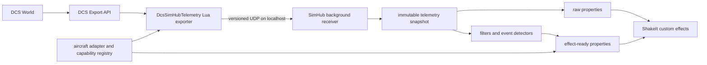

# DCS Extra Telemetry for SimHub — Design Plan

## 1. Purpose

Build a SimHub plugin and companion DCS Lua exporter that expose telemetry not present in SimHub's normal property list, primarily for ShakeIt Bass Shakers effects.

The system must:

- install alongside SimHub's existing DCS integration;
- remain installation-agnostic and coexist with arbitrary third-party DCS tools;
- never read, write, reorder, repair, or depend on the user's `Export.lua`;
- detect the active aircraft automatically;
- expose every supported value as a stable SimHub property;
- identify unavailable aircraft-specific values explicitly;
- produce clean, normalized effect signals suitable for ShakeIt formulas;
- remain safe when DCS, SimHub, or telemetry packets stop unexpectedly.

The first release is a telemetry provider. It will not generate audio itself or replace ShakeIt. ShakeIt will consume the properties and generate the shaker signal.

## 2. Verified Local Baseline

This design targets the locally installed SimHub 9.11.17 environment.

- The bundled Plugin SDK targets .NET Framework 4.8.
- A data plugin implements `IPlugin` and `IDataPlugin`; a settings page may implement `IWPFSettingsV2`.
- Custom properties are registered with `AttachDelegate` and evaluated on demand.
- SimHub's `DataUpdate` method is on a critical path and must not perform socket reads, parsing, blocking, or expensive calculations.
- SimHub's SDK describes raw game data as intentionally hidden and says plugins should not use it.
- SimHub already ships a DCS Lua exporter that reads many standard `Export.LoGet...` values. The new project must not edit, replace, bind to, or depend upon that private transport.

Therefore the supported architecture is a separate, versioned loopback UDP feed owned by this project.

The Hook decision follows Eagle Dynamics' modular integration guidance: ED identifies Hook scripts as the solution to shared `Export.lua` maintenance, documents that `Export.*` exposes the export API in the GameGUI environment, and lists the ownship calls used by this project as available subject to multiplayer ownship-export policy. See the [ED Hook discussion](https://forum.dcs.world/topic/244304-exportlua-mess-hard-to-maintain/) and [ED export-permission/API list](https://forum.dcs.world/topic/138457-new-file-integrity-check/page/7/).

### Compatibility contract

Compatibility is a hard product requirement. The normal installer and runtime must make no assumptions about which third-party tools are installed or the order in which they were installed.

- Install only uniquely named files owned by this project.
- Use the modular DCS GameGUI Hook mechanism under `Saved Games\DCS*\Scripts\Hooks`.
- Register an independent callback table through `DCS.setUserCallbacks`.
- Never define, replace, capture, or chain the legacy global `LuaExport*` functions.
- Never inspect or modify another tool's files, callback tables, globals, sockets, or configuration.
- Never include an automatic or hidden `Export.lua` fallback.
- Use only local Lua state, nonblocking loopback UDP, a configurable dedicated port, and callbacks that return no value.
- When DCS, an aircraft, or a multiplayer server does not expose a requested value through Hooks, publish that capability as unsupported. Missing telemetry must not cause the plugin to switch integration methods.
- A failure in this exporter must disable only this exporter; it must not escape a callback or affect another Hook.

No software can guarantee operation alongside an arbitrary third-party component that corrupts DCS files, monopolizes resources, or crashes the simulator. The enforceable guarantee is that this project does not participate in the shared `Export.lua` callback chain and does not mutate or depend on other installations.

## 3. Architecture



### Runtime boundary

1. DCS calls the Lua exporter during simulation frames.
2. Lua reads standard export functions and the active aircraft adapter.
3. Lua sends each compact UDP datagram to the SimHub plugin on `127.0.0.1:29381` and mirrors it to the optional recorder on `127.0.0.1:29382` by default. Both streams remain local and independent. The launcher may save a validated, distinct port pair in `%LOCALAPPDATA%\DcsExtraTelemetry\ports.ini`; the Hook and plugin read that same per-user file at startup. Either key may be supplied independently, invalid settings are logged, and colliding ports safely fall back to the defaults.
4. A background C# receiver validates and parses the packet, computes derived signals, and atomically publishes an immutable snapshot.
5. SimHub property delegates only read the latest snapshot. They never wait on the network.
6. ShakeIt formulas consume properties under the plugin's stable namespace.

## 4. Repository Layout

```text
/
├─ src/
│  ├─ DcsExtraTelemetry.Plugin/       SimHub .NET Framework 4.8 plugin
│  ├─ DcsExtraTelemetry.Core/         protocol, filters, detectors, adapters
│  └─ DcsExtraTelemetry.Replay/       packet capture/replay diagnostic tool
├─ dcs-export/
│  ├─ entry.lua                       DCS callback registration and lifecycle
│  ├─ protocol.lua                    packet construction and serialization
│  ├─ standard.lua                    documented/general export values
│  └─ aircraft/                       aircraft-specific adapter modules
├─ tests/
│  ├─ DcsExtraTelemetry.Core.Tests/
│  ├─ fixtures/                       recorded packets and expected outputs
│  └─ lua/                            exporter tests where practical
├─ profiles/
│  └─ ShakeIt/                        example effect profile and formulas
├─ scripts/
│  ├─ Install-Plugin.ps1
│  ├─ Install-DcsHook.ps1
│  └─ Verify-Installation.ps1
└─ docs/
   ├─ DESIGN.md
   ├─ PROPERTIES.md                    generated property reference
   └─ AIRCRAFT.md                      adapter support matrix
```

## 5. DCS Lua Exporter

### 5.1 Installation and coexistence

Install a uniquely named loader at `Saved Games\DCS*\Scripts\Hooks\DCSExtraTelemetry.lua` and place its private modules under `Saved Games\DCS*\Scripts\DCSExtraTelemetry`. DCS automatically loads the Hook; no loader line is added anywhere.

The Hook registers its own callback table with `DCS.setUserCallbacks`. It does not define or capture `LuaExportStart`, `LuaExportStop`, `LuaExportBeforeNextFrame`, `LuaExportAfterNextFrame`, or `LuaExportActivityNextEvent`. Every callback and aircraft adapter is protected by an error boundary so a fault disables only this exporter.

Installation is additive and atomic. The installer may replace an older version of this project's own files, but it may not open or rewrite `Export.lua` or any other Hook. Uninstall removes only paths owned by this project.

### 5.2 Collection rate

- Read/schedule at DCS simulation-frame cadence.
- Transmit at a configurable 60 Hz default.
- Send an immediate identity/capability packet when a mission starts or the aircraft changes.
- Do not attempt to transmit bass frequencies. High-frequency shaker waveforms remain ShakeIt's job; telemetry supplies amplitude and event envelopes.

### 5.3 Data sources

Sources are ordered from most portable to most aircraft-specific:

1. Standard DCS export functions such as acceleration, angular velocity, airspeed, vertical velocity, angle of attack, engine information, shake amplitude, and mechanical state.
2. Common external model/draw arguments where their meaning is verified.
3. Per-aircraft cockpit device or argument mappings maintained in an adapter.
4. Derived signals calculated from a combination of valid inputs.

Every read must use a protected call. Missing functions, `nil`, invalid table shapes, `NaN`, infinity, and unreasonable values are rejected at the source.

### 5.4 Aircraft identification

Aircraft identity comes from `LoGetSelfData()` when available. The adapter registry normalizes the returned type into an internal key. A packet contains both the raw DCS type and normalized adapter ID.

Aircraft changes reset all filters and event state. Values from the previous aircraft must never leak into the new aircraft snapshot.

### 5.5 Capability detection

Capability detection is not based on whether a numeric value happens to be zero. A stationary but supported value may legitimately remain zero.

A field is supported when:

- its standard API call succeeds and returns the expected shape; or
- the selected aircraft adapter explicitly declares and validates its source; and
- any inputs required for a derived field are supported.

Each capability has one of four states:

- `supported`: source is known and valid;
- `degraded`: an effect is available through a lower-confidence fallback;
- `unsupported`: no trustworthy source exists for this aircraft;
- `stale`: the source was supported but packets are no longer current.

The Lua exporter sends the source capabilities. The C# plugin adds capabilities for its derived signals.

### 5.6 Installation-neutral weapon events

Weapon inventory and effect triggers use only the standard ownship `LoGetPayloadInfo()` result already reachable through the isolated GameGUI Hook. The exporter samples `Cannon.shells` and each `Stations[index].count`. After seeding a baseline, a decrease produces a short effect pulse; increases are treated as rearming and never as firing. Shell-type station decreases are classified as station-gun ammunition, while other station decreases are classified as payload releases. Station comparisons also require the weapon type to remain the same, preventing a changed loadout from creating a false event.

The derived signals are:

- a combined weapon-fire pulse;
- combined cannon/station-gun pulses and reported round deltas;
- optional crew-gun and left/right pulses when an aircraft adapter has a source-verified station mapping;
- a station-release pulse and reported payload-count delta;
- current selected station/name, last-fired station/name, station-gun ammunition, total station count, cannon shells, and an event counter.

Tracking resets on simulation start, simulation stop, aircraft change, or loss of the payload source. No mission script, `Export.lua` callback, or third-party-mod file is changed. Optional aircraft adapters are internal and read-only. Weapon events remain based on the standard payload result; guarded cockpit and draw arguments may add module-specific state only when their source and range are documented and capability-gated.

DCS does not expose a universal ownship field identifying a door gun separately from another station-mounted gun. All shell-type stations therefore drive the generic station-gun pulse. A source-verified aircraft adapter may additionally label known stations as left/right crew guns. The UH-60L version 1.5 adapter maps payload station 3 to the left gun and station 5 to the right gun. Module-specific cockpit arguments are additive, guarded, and capability-gated; their absence never disables the generic payload path.

In this document, a `degraded` fallback means only a lower-confidence calculation from data already available through the same Hook. It never means falling back to `Export.lua`, another mod, process injection, or installation-specific configuration.

## 6. Wire Protocol

Use UTF-8 JSON for version 1 because it is inspectable during development and DCS already includes a JSON module. Optimize only after measurement proves it necessary.

Example packet:

```json
{
  "protocol": 1,
  "sequence": 1842,
  "sentAtMs": 392812.51,
  "modelTime": 427.25,
  "aircraft": {
    "dcsType": "FA-18C_hornet",
    "adapter": "fa18c",
    "adapterVersion": 1
  },
  "capabilities": {
    "acceleration": "supported",
    "angularVelocity": "supported",
    "weightOnWheels": "supported",
    "weaponPayload": true,
    "weaponEvents": true
  },
  "values": {
    "acceleration": { "x": 0.01, "y": 1.03, "z": -0.02 },
    "angularVelocity": { "x": 0.0, "y": 0.01, "z": 0.0 },
    "verticalVelocityMps": -0.4,
    "angleOfAttackRad": 0.12,
    "shakeAmplitude": 0.03,
    "weapons": {
      "selectedStation": 2,
      "selectedWeaponName": "weapons.shells.HYDRA_70_M151",
      "totalPayloadCount": 14,
      "cannonShells": 497,
      "weaponFirePulse": 1,
      "gunFirePulse": 1,
      "payloadReleasePulse": 0,
      "gunRoundsFired": 3,
      "payloadReleasedCount": 0,
      "weaponEventCounter": 7
    },
    "weightOnWheels": { "nose": true, "left": true, "right": true }
  }
}
```

Protocol requirements:

- Maximum one datagram per sample; target less than 8 KB.
- Monotonically increasing sequence number within a DCS session.
- A protocol version on every packet.
- Unknown fields are ignored for forward compatibility.
- Missing or unsupported values are omitted, never replaced with zero.
- The receiver accepts packets only from loopback by default.
- Packets with the wrong version, invalid types, excessive size, or non-finite numbers are dropped and counted.

### 6.1 Launcher update trust boundary

Portable packages contain a signed-in-manifest `package-info.json` with the package version and fixed private repository identifier. The launcher uses GitHub CLI for private-release API and download operations so authentication remains in GitHub's credential store; the application never embeds or persists a token.

An update is eligible only when its tag matches the supported semantic form, its version is newer than the current package, and the release contains the exact versioned ZIP asset with a GitHub SHA-256 digest. Before any installer script runs, the updater:

1. verifies the downloaded ZIP against the GitHub release digest;
2. extracts into a unique staging directory while rejecting traversal, duplicate paths, excessive entry counts, and excessive expanded sizes;
3. verifies every extracted file against `manifest.sha256` and rejects unsigned extras;
4. validates the packaged version and repository metadata;
5. captures a fresh unrelated-file baseline;
6. replaces only the project-owned Hook and plugin files;
7. verifies the unrelated-file baseline again.

Verified packages are retained under the current user's local application-data folder. Install state records only version and local paths. It allows an older launcher to redirect to the newest verified launcher and restores the previously confirmed DCS and SimHub paths; it contains no credentials.

## 7. SimHub Plugin

### 7.1 Plugin lifecycle

The plugin implements:

- `IPlugin` for initialization and shutdown;
- `IDataPlugin` for safe integration with SimHub's data lifecycle;
- `IWPFSettingsV2` for settings and diagnostics.

`Init` loads settings, registers every stable property delegate, starts the receiver, and logs the selected port. `End` cancels the receiver, closes the socket, waits briefly for shutdown, and saves settings.

### 7.2 Threading model

- One background receiver owns the UDP socket.
- Parsing and derived calculations occur off SimHub's update thread.
- The receiver publishes a complete immutable snapshot using an atomic reference exchange.
- Property delegates perform simple null-safe reads from the current snapshot.
- `DataUpdate` only observes SimHub game-running state if needed; it never performs I/O.
- All background exceptions are caught, rate-limited in logs, and surfaced as diagnostics.

### 7.3 Connection state

- `Connected` becomes true after the first valid packet.
- Data is considered stale after 250 ms by default.
- Connection is considered lost after 1,000 ms by default.
- On stale/lost state, continuous effect outputs decay quickly to zero and event pulses are cleared.
- Reconnection resets sequence, filter, and event-detector state.

### 7.4 Settings and diagnostics page

The SimHub settings page will show:

- receiver enabled state and UDP port;
- exporter installation status for detected DCS Saved Games installations;
- connection, packet rate, dropped packets, and current data age;
- raw DCS aircraft type and selected adapter;
- capability state and live value for each requested signal;
- filter strength and effect sensitivity presets;
- buttons to install/repair the exporter, open logs, and record a short diagnostic capture.

The page will not require DCS to be running to edit settings.

## 8. SimHub Property Contract

The intended short namespace is `DCSExtra`. The exact fully qualified name shown by SimHub will be confirmed by the first SDK spike and then frozen before profiles are published.

### 8.1 Diagnostic and identity properties

| Property | Type | Meaning |
|---|---:|---|
| `DCSExtra.Connected` | Boolean | Valid, non-stale packets are arriving |
| `DCSExtra.DataAgeMs` | Number | Age of the last valid packet |
| `DCSExtra.PacketRateHz` | Number | Measured receive rate |
| `DCSExtra.DroppedPackets` | Number | Sequence gaps plus invalid packet count |
| `DCSExtra.ProtocolVersion` | Number | Active protocol version |
| `DCSExtra.AircraftType` | String | Raw DCS aircraft type |
| `DCSExtra.AircraftAdapter` | String | Selected internal adapter |

### 8.2 Capability properties

For every effect signal, expose both:

- `DCSExtra.Capability.<Name>` as a string state;
- `DCSExtra.Has.<Name>` as a convenient Boolean that is true only for `supported` or an explicitly accepted `degraded` fallback.

This lets a ShakeIt formula gate an effect without confusing unsupported data with a real zero.

### 8.3 Raw and normalized properties

Raw engineering values retain units in their property names. Normalized values use a `0.0` to `1.0` contract unless documented otherwise.

| Group | Initial properties |
|---|---|
| Acceleration | `AccelXG`, `AccelYG`, `AccelZG`, `VerticalImpactG` |
| Rotation | `AngularXRadS`, `AngularYRadS`, `AngularZRadS` |
| Air data | `AirspeedMps`, `VerticalVelocityMps`, `AngleOfAttackRad`, `Mach` |
| Engines | `EngineRpmLeftPct`, `EngineRpmRightPct`, `EngineActivity` |
| Airframe | `GearNose`, `GearLeft`, `GearRight`, `Flaps`, `Speedbrake` |
| Contact | `WeightOnWheelsNose`, `WeightOnWheelsLeft`, `WeightOnWheelsRight` |
| DCS feedback | `ShakeAmplitude` |

## 9. Effect Signal Plan

Effect-ready signals should be stable enough to use directly as ShakeIt amplitudes. All signals reset on aircraft/session changes and decay to zero when their input becomes stale.

| Effect property | Primary inputs | Detection/normalization | Initial support |
|---|---|---|---|
| `Effect.Touchdown` | vertical acceleration, vertical velocity, weight-on-wheels transition | short impulse scaled by sink rate/impact, with debounce | Generic when trustworthy WoW exists; adapter otherwise |
| `Effect.GroundRoll` | WoW, ground speed, shake/acceleration variation | band-limited roughness envelope, speed-gated | Generic/degraded |
| `Effect.GearMovement` | gear positions and their rate of change | amplitude while extending/retracting, plus endpoint bump | Generic if gear position exists |
| `Effect.FlapsMovement` | flap position and rate of change | amplitude while moving, optional endpoint bump | Generic if flap position exists |
| `Effect.SpeedbrakeMovement` | speedbrake position and rate | movement envelope | Generic if position exists |
| `Effect.SpeedbrakeFlow` | speedbrake position and airspeed | position × normalized dynamic-pressure proxy | Generic/degraded |
| `Effect.EngineLeft` | left RPM | smoothed RPM-based amplitude for ShakeIt frequency mapping | Generic if engine data exists |
| `Effect.EngineRight` | right RPM | smoothed RPM-based amplitude for ShakeIt frequency mapping | Generic if engine data exists |
| `Effect.AfterburnerLeft` | verified AB state or aircraft adapter source | attack/release envelope; RPM heuristic only as degraded | Adapter-first |
| `Effect.AfterburnerRight` | verified AB state or aircraft adapter source | attack/release envelope; RPM heuristic only as degraded | Adapter-first |
| `Effect.Buffet` | DCS shake, AoA, acceleration variation | high-pass/variance envelope with airspeed gate | Generic where shake exists |
| `Effect.StallBuffet` | AoA, shake, airspeed, aircraft thresholds | adapter threshold curve plus shake envelope | Adapter-first |
| `Effect.GunRecoil` | verified weapon-fire state | retriggerable fixed-duration pulse | Aircraft adapter/experimental |

### Important confidence rules

- Engine RPM above a threshold is not automatically called afterburner. It may be offered only as a user-enabled degraded fallback.
- Gear extension is not automatically weight-on-wheels. WoW requires a verified contact/strut source or a clearly labeled degraded inference.
- A cockpit trigger input is not automatically gun firing. Recoil is published only when an adapter has a trustworthy firing indication or a validated event detector.
- Unsupported effect signals remain gated off even if their backing numeric property defaults to zero in SimHub.

## 10. Filtering and Event Detection

Use small, deterministic filters whose parameters can be unit-tested:

- exponential moving average for continuous gauges such as RPM and control positions;
- high-pass or rolling variance for vibration/buffet envelopes;
- hysteresis for Boolean thresholds;
- debounce for weight-on-wheels transitions;
- attack/hold/release envelopes for touchdown, endpoint bumps, and recoil;
- clamping after filtering to preserve a documented normalized range.

Filters use DCS model time or packet timestamps, not an assumed fixed frame interval. Long time gaps reset state instead of generating a large artificial impulse.

## 11. Aircraft Adapter Model

Each adapter declares:

- recognized DCS aircraft type strings;
- adapter version;
- cockpit/draw argument sources with expected ranges;
- capability states and confidence;
- aircraft-specific thresholds such as stall AoA;
- optional source validation rules;
- unit conversion or inversion required by that module.

The generic adapter contains only verified standard export values. Unknown aircraft automatically use the generic adapter; the system continues publishing portable properties and reports aircraft-specific effects as unsupported.

Adapters must be data-driven where possible so adding an aircraft rarely changes receiver code. Aircraft mappings are tested from recorded captures before being marked supported.

## 12. Installation and Packaging

The release package contains:

- plugin DLL and PDB;
- any language `.resx` files;
- DCS Lua exporter directory;
- PowerShell installer and verifier;
- property reference and example ShakeIt profile.

Installation flow:

1. Stop SimHub and DCS.
2. Copy the plugin DLL into the detected SimHub directory. Administrative permission may be required for `Program Files`.
3. Copy the Lua module into each selected DCS Saved Games `Scripts\DCSExtraTelemetry` directory.
4. Atomically install the uniquely named loader in each selected `Scripts\Hooks` directory without reading or changing `Export.lua`.
5. Start SimHub, enable the plugin if necessary, and verify the UDP listener.
6. Start a DCS mission and confirm identity, packet health, and capabilities.
7. Import the example ShakeIt profile or add custom effects using the documented properties.

Uninstall removes only the Hook and module files owned by this project. It does not inspect or change `Export.lua` or another tool's files.

## 13. Development Phases

### Phase 0 — Discovery spike

- Scaffold the .NET Framework 4.8 SimHub plugin from the installed SDK demo.
- Confirm the exact property prefix produced by `AttachDelegate`.
- Inventory SimHub's native DCS properties during a live mission to avoid duplicate work.
- Verify that installing, running, disabling, and uninstalling the Hook leaves `Export.lua` byte-for-byte unchanged.
- Verify callback coexistence independent of Hook filename/load order.
- Capture representative packets from at least one aircraft.

Exit criterion: a diagnostic property appears in SimHub and an independent Lua heartbeat reaches the plugin without disrupting native DCS telemetry.

### Phase 1 — Transport and diagnostics

- Implement protocol v1, UDP receiver, immutable snapshots, stale handling, logging, and settings.
- Implement exporter installation/verification scripts.
- Publish connection, identity, packet-rate, and capability properties.
- Add packet capture/replay tooling.

Exit criterion: connection loss/restart/aircraft change are handled correctly and replay tests are deterministic.

### Phase 2 — Generic raw telemetry

- Add standard acceleration, rotation, air-data, engine, gear, flap, speedbrake, and DCS shake values.
- Add unit/range validation and generated property documentation.
- Confirm properties are selectable in ShakeIt formulas.

Exit criterion: every published property has documented units, validation, stale behavior, and a capability flag.

### Phase 3 — Generic effect signals

- Implement touchdown, ground roll, gear/flap/speedbrake movement, engine, and buffet detectors.
- Tune using packet captures rather than live-only trial and error.
- Build a conservative example ShakeIt profile with capability gating.

Exit criterion: effects do not false-trigger during pause, aircraft change, connection loss, or ordinary steady flight.

### Phase 4 — Aircraft-specific adapters

- Choose the first aircraft from actual user priority.
- Map and validate WoW, afterburner, stall thresholds, and gun-fire/recoil sources where available.
- Document tested DCS/module versions and confidence level.
- Repeat through prioritized aircraft.

Exit criterion: each supported mapping has a fixture or documented live test and never silently falls back to an unrelated argument.

### Phase 5 — Release hardening

- Run installation, upgrade, repair, and uninstall tests.
- Test coexistence with SimHub, SRS, Tacview, DCS-BIOS, SimShaker, Winwing/SIMAPP Pro, VAICOM, Helios, DCS-ExportScripts, and deliberately malformed unrelated exporters.
- Hash all pre-existing files before and after every lifecycle test and require them to remain unchanged.
- Fault-inject missing modules, syntax-safe runtime errors, an occupied UDP port, a stopped SimHub receiver, and restricted multiplayer exports; only this integration may fail.
- Measure packet size, CPU usage, allocation rate, packet loss, and end-to-end latency.
- Produce a versioned ZIP release and migration notes.

Exit criterion: clean installation on a second machine/profile and a complete smoke test pass.

## 14. Test Strategy

### Automated tests

- JSON schema/version validation and malformed packet rejection.
- Sequence-gap, duplicate, and out-of-order packet handling.
- Stale/lost/reconnect state transitions.
- Unit conversions and non-finite/range rejection.
- Filters with variable sample intervals.
- Touchdown debounce and attack/hold/release envelopes.
- Capability propagation and unsupported-value gating.
- Aircraft change resets.
- Recorded packet replay with expected effect traces.

### Manual integration matrix

For each aircraft selected for support:

- cold/dark and engines running;
- taxi at several speeds;
- takeoff and gear retraction;
- flap/speedbrake movement;
- clean cruise and high-AoA maneuvering;
- landing with gentle and firm touchdowns;
- afterburner transitions when applicable;
- gun firing when a verified source exists;
- pause/unpause, mission restart, aircraft slot change, DCS exit, and SimHub restart.

### Performance targets

- Default telemetry rate: 60 Hz.
- Typical datagram: less than 8 KB.
- Added end-to-end telemetry latency: less than 50 ms on localhost.
- No blocking work in `DataUpdate` or property delegates.
- Continuous plugin CPU usage should remain negligible on the target PC and be measured before release.

## 15. Definition of Done for Version 1

Version 1 is complete when:

- installation, upgrade, repair, and uninstall leave `Export.lua` and every unrelated Hook byte-for-byte unchanged;
- the product works without editing, ordering, or configuring third-party mods;
- renaming this Hook to load first or last does not change another integration's behavior;
- exporter initialization, runtime, serialization, socket, and shutdown failures remain isolated to this exporter;
- the SimHub plugin loads without errors on the target SimHub version;
- the active aircraft and adapter are detected automatically;
- connection and capability status are visible in SimHub;
- generic raw properties appear in SimHub's available properties list;
- at least touchdown, gear movement, engine activity, and buffet have working effect-ready outputs;
- ShakeIt can use those outputs through an example profile;
- unsupported WoW, afterburner, stall, or gun-recoil data is clearly reported and produces no false effect;
- recorded replay tests, live mission smoke tests, and disconnect/reconnect tests pass;
- property names and protocol version are documented and frozen for the v1 release.

## 16. Decisions Needed Before Aircraft-Specific Work

The generic foundation can be built without further decisions. Phase 4 requires:

1. the first one or two DCS aircraft to support;
2. the physical shaker/channel layout;
3. the most important effects in priority order;
4. whether degraded heuristic signals may be enabled, or only verified sources are acceptable.

These choices affect adapter mappings and tuning, but not the core architecture.
